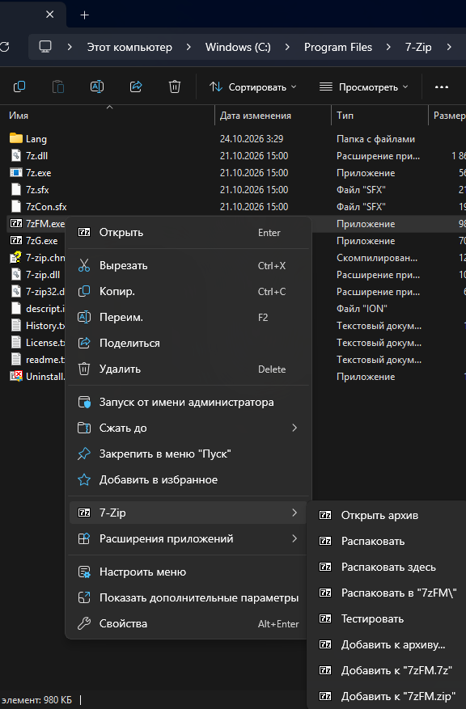
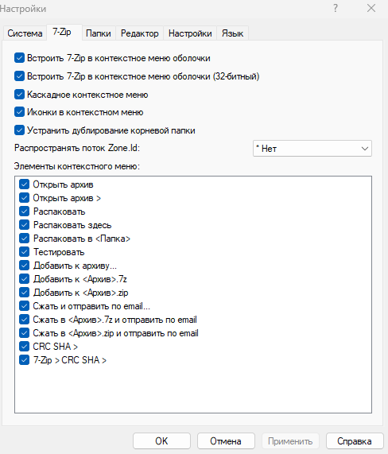
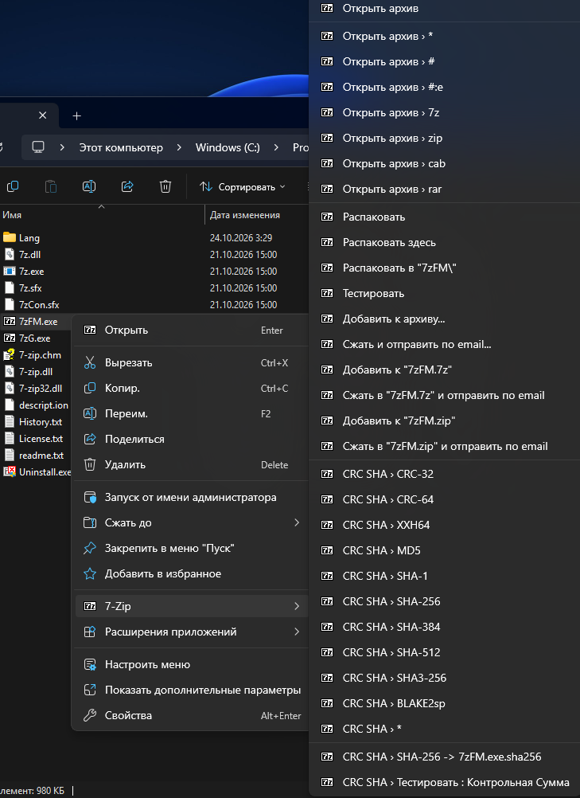
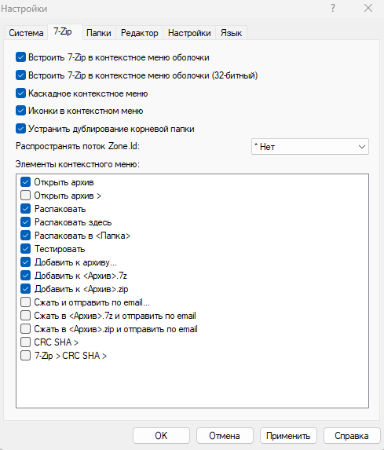
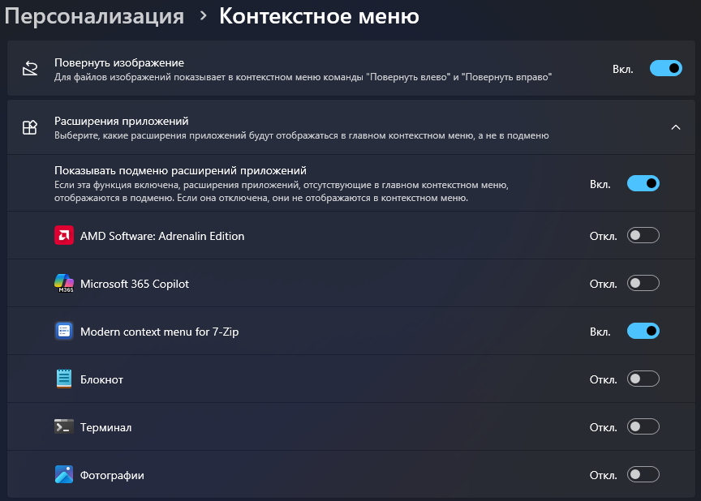

<p align="center"></p>

# 7-Zip Modern Context Menu для Windows 11

**Новое контекстное меню Windows 11 для 7-Zip.** Добавляет полное меню 7-Zip в новое меню правой кнопки мыши,
чтобы не нажимать «Показать дополнительные параметры».

🇬🇧 [English version](README.en.md)

<p align="center"></p>

## Возможности
- Все пункты 7-Zip в новом меню: открыть, распаковать, тестировать, добавить к архиву, CRC SHA и другие.
- Пункты, порядок, язык и значки берутся **из установленного у вас 7-Zip**, поэтому всё совпадает с классическим меню.
- Настройки 7-Zip продолжают работать: *7-Zip File Manager → Сервис → Настройки → 7-Zip* (скрыть пункты, каскад, значки).
- Работает для файлов и папок, в том числе при выделении нескольких объектов.
- Сборки для x64 и ARM64 (ARM64 пока экспериментальная).
- Ничего от 7-Zip не включено и не изменено. Открытый код, лицензия MIT, сборка публично через GitHub Actions.

## Скриншоты
Меню всегда повторяет настройки вашего 7-Zip.

<table>
  <tr>
    <th>Настройки 7-Zip</th>
    <th>Результат в новом меню Windows 11</th>
  </tr>
  <tr>
    <td></td>
    <td></td>
  </tr>
  <tr>
    <td></td>
    <td></td>
  </tr>
</table>

### Где появится пункт
В сборках Windows 11, где есть страница *Параметры → Персонализация → Контекстное меню → Расширения приложений*,
вы выбираете, показывать ли пункт в главном меню (переключатель **Вкл.**, как на снимке) или внутри подменю
«Расширения приложений».



## Требования
- Windows 11 (проверено на Windows 11 Pro 26H2).
- [7-Zip](https://www.7-zip.org/) той же архитектуры, что и ваша Windows (**x64** или **ARM64**), установленный обычным образом (проверено на x64 7-Zip 26.05).
- В настройках 7-Zip должна оставаться включённой галочка **«Встроить 7-Zip в контекстное меню оболочки»**.
  Расширение использует именно её.

## Установка

### Вариант 1: установщик (рекомендуется)
1. Откройте страницу [Releases](../../releases) и скачайте `ModernMenu7z-<версия>-Setup.exe`. Один файл подходит и для x64, и для ARM64: он сам выбирает нужную сборку.
2. Запустите его и подтвердите запрос администратора (UAC). Панель задач может на мгновение мигнуть: перезапускается проводник.
3. Нажмите правой кнопкой на любой файл или папку. Пункт **7-Zip** появится в новом меню.

Тихая установка (без окон): `ModernMenu7z-<версия>-Setup.exe /VERYSILENT /SUPPRESSMSGBOXES /NORESTART`.
Удалить можно в *Параметры → Приложения → Установленные приложения*.

### Вариант 2: архив
1. Откройте страницу [Releases](../../releases) и скачайте `ModernMenu7z-<версия>-x64.zip` (большинство ПК) или `ModernMenu7z-<версия>-arm64-beta.zip` (Windows на ARM, бета).
2. Распакуйте архив в любую папку (не запускайте файлы изнутри архива).
3. Дважды щёлкните **`install.cmd`** и подтвердите запрос администратора (UAC).
4. Дождитесь сообщения «Done» и нажмите Enter. Панель задач может на мгновение мигнуть: перезапускается проводник.
5. Нажмите правой кнопкой на любой файл или папку. Пункт **7-Zip** появится в новом меню.

Если пункта нет, выйдите из учётной записи Windows и войдите снова.

### Проверка файла (по желанию)
Сравните SHA-256 архива с файлом `SHA256SUMS.txt` из релиза:
`certutil -hashfile ModernMenu7z-<версия>-x64.zip SHA256`

## Удаление
Если ставили установщиком: *Параметры → Приложения → Установленные приложения → Modern context menu for 7-Zip → Удалить*.
Если ставили из архива: запустите **`uninstall.cmd`** из распакованной папки.

## Известные ограничения
- **Вложенные подменю «разворачиваются».** Новое меню Windows 11 поддерживает только один уровень подменю
  ([документация Microsoft](https://learn.microsoft.com/windows/win32/api/shobjidl_core/nf-shobjidl_core-iexplorercommand-enumsubcommands)).
  Группы 7-Zip вроде *CRC SHA* выглядят как пункты `CRC SHA › SHA-256`. Ненужные можно скрыть в настройках 7-Zip.
- **ARM64 экспериментальная:** собирается автоматически, но на реальном ARM64-устройстве пока не проверена. Отчёты приветствуются.
- Нужен классический обработчик 7-Zip (см. «Требования»).
- Диски (C:, D:...) не поддерживаются: Windows разрешает расширениям нового меню только файлы и папки. Для диска используйте «Показать дополнительные параметры».
- Меню для пустого места внутри папки (фон) не поддерживается: в классическом меню 7-Zip его тоже нет.

## Как это работает
Расширение реализует `IExplorerCommand` и регистрируется через подписанный *sparse MSIX-пакет*.
При правом щелчке оно запрашивает у установленного 7-Zip его классическое меню (`IContextMenu`) и показывает те же
пункты в новом меню. Нажатия передаются обратно в 7-Zip. См. [`src/dllmain.cpp`](src/dllmain.cpp).

## О сертификате
Windows принимает только подписанные пакеты, поэтому релизы подписаны сертификатом автора (`CN=Djon934`).
Установщик добавляет этот **публичный** сертификат в «Доверенные лица» на вашем компьютере. Это значит, что Windows
будет доверять и другому ПО, подписанному тем же ключом. Если вас это не устраивает, соберите проект сами (см. ниже)
со своим сертификатом или удалите сертификат после установки: `Win+R → certlm.msc → Trusted People → Certificates`.
Установленное расширение продолжит работать и после удаления сертификата.

## Если что-то не работает
**Пункта нет в главном меню?** Откройте *Параметры → Персонализация → Контекстное меню → Расширения приложений* и включите
«Modern context menu for 7-Zip» (или поищите пункт в подменю «Расширения приложений»).

Включите журнал и щёлкните правой кнопкой по файлу:
```
reg add HKCU\Software\ModernMenu7z /v Debug /t REG_DWORD /d 1 /f
```
Журнал лежит в `%LOCALAPPDATA%\ModernMenu7z\log.txt`. Приложите его к обращению (issue).

## Сборка самостоятельно
Сделайте форк, включите GitHub Actions и отправьте коммит. Workflow `CI` соберёт артефакт, подписанный временным
тестовым сертификатом. Для собственного постоянного сертификата запустите `tools/New-SigningCertificate.cmd` и добавьте
секреты `SIGN_PFX_BASE64` и `SIGN_PFX_PASSWORD` (в репозитории *Settings → Secrets and variables → Actions*).
Релиз создаётся тегом `vX.Y.Z`, совпадающим с файлом `VERSION`.

## Отказ от ответственности
Программа предоставляется **«как есть»**, без каких-либо гарантий. Вы используете её на свой страх и риск.
Установщик устанавливает пакет Windows, добавляет сертификат в «Доверенные лица» и перезапускает проводник.
Автор не несёт ответственности за любой ущерб или потерю данных. Проект **не связан** с проектом 7-Zip
(Игорь Павлов) и Microsoft и не одобрен ими. 7-Zip и Windows принадлежат их владельцам.
См. [NOTICE.md](NOTICE.md).

## Авторство
Автор проекта: [Djon934](https://github.com/Djon934). Код, скрипты сборки и документация написаны с помощью
**Claude** (ИИ-ассистент компании Anthropic) и проверены автором на Windows 11. Значок проекта нарисован специально для него.

## Лицензия
[MIT](LICENSE) © 2026 Djon934
